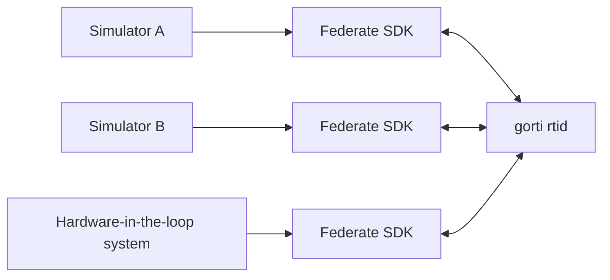

# gorti

[](https://github.com/cbchoi/gorti/actions/workflows/ci.yml)
[](https://github.com/cbchoi/gorti/actions/workflows/docs.yml)
[](https://github.com/cbchoi/gorti/releases)
[](LICENSE)
[](https://pkg.go.dev/github.com/cbchoi/gorti)

gorti is an open-source IEEE 1516-2010 (HLA Evolved) Run-Time
Infrastructure written in Go. It includes a standalone RTI server and federate
SDKs for Go, Python, and Java. The [Java SDK](javasdk/) provides the
`hla.rti1516e` language mapping. All three clients use the same server for
federation services, Float64 and Integer64 logical time, and save/restore.

## The problem HLA solves

Federated simulations combine independently developed models. A vehicle model
may be written in Java, an environment model in Python, and a hardware-in-the-loop simulator may
run on another machine. Those programs need a shared model of data, time, and
ownership.

[High Level Architecture (HLA)](https://standards.ieee.org/ieee/1516/4118/)
is the international standard used to connect these independently developed
simulators. The RTI is the middleware that implements the standard. It manages
federation membership, object state, interactions, logical time, ownership,
and data distribution.

HLA/RTI is used in defense, aerospace, transportation, manufacturing, digital
twins, and training systems. An open implementation matters because its
ordering rules, failure behavior, and performance tradeoffs can be inspected
and reproduced.



## Why another open RTI?

[Portico](https://github.com/openlvc/portico) and
[OpenHLA](https://sourceforge.net/projects/ohla/) provide open-source HLA
implementations. gorti adds a Go server and native Go and Python interfaces
alongside the standard Java mapping. Developers can reuse models across these
languages, compare RTI behavior, and study service algorithms in separate Go
packages.

The Go server builds as a standalone executable. Goroutines handle concurrent
requests and callback streams, while bounded queues control admission and
backpressure. LocalLRC batching and cumulative acknowledgements reduce
per-message network round trips.

| | Portico | gorti |
|---|---|---|
| Implementation | Java RTI core | Go RTI server |
| Standards target | HLA 1.3, IEEE 1516, and IEEE 1516e | IEEE 1516-2010 |
| License | CDDL | MIT |
| Project emphasis | Mature deployment and broad legacy API coverage | Inspectable implementation, documented contracts, and reproducible tests |

Measured Portico comparisons are reported separately in
[performance](docs/performance.md), with their workloads and timing boundaries.

## Current scope

The supported deployment is one authoritative `rtid` process with Go, Python,
or Java federates. The repository covers federation, declaration, object, time,
ownership, data distribution, synchronization, save/restore, and management
object services.

Go and Python are the primary development interfaces. Java provides the
IEEE 1516.1-2010 language mapping, including ownership, DDM, save/restore,
callbacks, and encoding helpers. See its
[service coverage](javasdk/README.md#service-coverage) for API details.
C++ is outside the supported SDK set; retained C++ code and fixtures are legacy
development material.

The [requirements inventory](engineering/verification/requirements2010/README.md)
links reviewed IEEE clauses to implementation locations, test assertions, and
recorded executions. [Verification](docs/verification.md) summarizes the latest
complete service run and subsequent regressions.

`rtid` runs the HLA core profile by default. Binary audit journaling and
bounded replay are provided by the optional `auditreplay` runtime plugin, so
their encoding and storage work is absent from the normal federation path.
See the [operations guide](docs/operations.md) to enable it.

The single-server deployment supports model integration, distributed-simulation
teaching, federate development, and repeatable experiments. Cluster algorithms
remain experimental. The standards target is the 2010 family; older HLA API
generations are not provided.

## Try it

You need Go 1.22 or later. Clone the repository and run the in-process
ping-pong check:

```bash
git clone https://github.com/cbchoi/gorti.git
cd gorti
go run ./rti/cmd/rtid -mode=pingpong-demo -pingpong-rounds=100 -log-format=text
```

To see federation-wide time coordination, run the two-federate TAR example.
It starts `rtid`, holds one federate at logical time zero for three seconds,
and checks that the other federate does not receive an early grant.

Linux or macOS:

```bash
bash examples/go-tar-wait/run.sh
```

Windows PowerShell:

```powershell
.\examples\go-tar-wait\run.ps1
```

A passing run includes:

```text
[waiter] TAR(5) requested; grant is now blocked by the peer at time 0
[waiter] GRANT(5) after 3s: PASS - peer TAR released the pending request
go-tar-wait: PASS - the peer delay held and then released TAR(5)
```

The [quickstart](docs/quickstart.md) shows the same run in separate terminals.
All runnable scenarios are listed in the [example catalog](examples/README.md).

## Federate SDKs

| SDK | Use case | Documentation |
|---|---|---|
| Go | Native federates, LocalLRC admission, and explicit confirmed operations | [`rti/pkg/federate`](rti/pkg/federate/) |
| Python | Async federates, automation, experiments, and simulator adapters | [`pysdk`](pysdk/) |
| Java | `hla.rti1516e` provider, evoked callbacks, Float64/Integer64 time, ownership, DDM, save/restore, and encoding helpers | [`javasdk`](javasdk/) |

The SDKs communicate with `rtid` through the versioned `rti.v1` Protobuf/gRPC
protocol. Cross-RTI tests run a separate federation on each RTI and compare
service results and callbacks.

## Verification

Tests cover HLA service state, FOM handling, encodings, callback ordering,
time advancement, teardown, and save/restore. The 4 October 2026 full service
run passed 3,349 Go tests, 2,157 Python tests, 591 Java tests, and 35 internal
IVCT-derived cases. The same Go service selection passed with the Linux race
detector. Subsequent callback optimizations passed 978 required IEEE-service
cases in each Go reporting profile on 8 October. The linked reports identify
the tested source, configuration, and runtime.

The traceability inventory contains 712 records: 639 applicable requirements
linked to passing tests, 48 not applicable, and 25 awaiting interpretation.
External certification and the remaining source review are tracked in
[verification](docs/verification.md).

Performance experiments live under [`benchmark`](benchmark/). DEVStone-HLA
generates receive-order object updates and interactions for two independent
federate processes. The paired and crossover runners record FOM bytes, payload
seeds, timing boundaries, logging settings, warm-ups, and execution order.
See [performance](docs/performance.md) for the October Portico results and
[reproducibility](docs/reproducibility.md) for the run designs.

## Connecting an existing simulator

An existing model can remain independent of HLA. A federate adapter maps model
outputs to HLA updates or interactions and delivers RTI callbacks to the
model's input transition.

The [pyjevsim real-model example](examples/pyjevsim-real-model/README.md) runs
two actual `pyjevsim.behavior_model.BehaviorModel` subclasses in separate
federate processes. The runner checks that every pulse sent by the generator is
received once and in order by the sink.

```bash
python -m pip install -e "./pysdk[dev,pyjevsim]"
python -m rti1516e._proto
bash examples/pyjevsim-real-model/run.sh
```

Use `.\examples\pyjevsim-real-model\run.ps1` for the last command on Windows.

## Engineering records

The implementation is maintained alongside four versioned engineering
documents:

| Document | Contents |
|---|---|
| [SRS](engineering/specifications/current/SRS.md) | Requirements, constraints, and non-goals |
| [SDD](engineering/specifications/current/SDD.md) | Architecture, state ownership, ordering, and failure handling |
| [IDD](engineering/specifications/current/IDD.md) | Service and wire interfaces |
| [STD](engineering/specifications/current/STD.md) | Test cases, observable semantics, and acceptance evidence |

Historical baselines are kept under `engineering/specifications/history` so a
requirement can be traced to the release in which it changed. The same material
supports classroom exercises that turn standalone simulators into federates
and inspect their callback and logical-time behavior.

## Build and test

```bash
go build ./...
go test ./...
make verify
make docs
```

The local toolchain and SDK prerequisites are documented in
[installation](docs/installation.md). The CI policy and contribution workflow
are in [CONTRIBUTING.md](CONTRIBUTING.md).

## Repository map

| Path | Contents |
|---|---|
| [`rti`](rti/) | Go RTI server, services, FOM support, optional audit/replay plugin, and Go SDK |
| [`pysdk`](pysdk/) | Python SDK and pyjevsim bridge |
| [`javasdk`](javasdk/) | Java `hla.rti1516e` API and service provider |
| [`examples`](examples/) | Runnable federations and simulator adapters |
| [`verification`](verification/) | Semantic and performance comparison harnesses |
| [`benchmark`](benchmark/) | Reproducible DEVStone-HLA Portico/gorti experiment |
| [`docs`](docs/) | User, operation, verification, and release documentation |
| [`engineering`](engineering/) | Current and historical SRS, SDD, IDD, and STD baselines |

Use [GitHub Issues](https://github.com/cbchoi/gorti/issues) for bugs and design
questions. Citation metadata is available in [`CITATION.cff`](CITATION.cff)
and [`codemeta.json`](codemeta.json). gorti is released under the
[MIT License](LICENSE).
