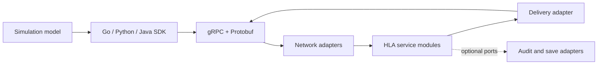

# Architecture

gorti runs one authoritative RTI server and connects independent federate
processes through a versioned Protobuf/gRPC protocol. Go, Python, and Java
SDKs translate service calls and callbacks. The Go LocalLRC also maintains
client-side admission state and a send queue; the server owns federation state
and validates committed operations.

## Server modules

The server keeps HLA behavior separate from transport and storage concerns:

| Area | Modules | Purpose |
|---|---|---|
| HLA services | `federation`, `declaration`, `object`, `time`, `ownership`, `ddm`, `synchronization`, `save_restore`, `mom`, `support` | Validate and apply federation state transitions |
| Application | `configuration`, `composition`, `lifecycle`, `server` | Select policies and assemble a runnable process |
| Adapters | `grpc`, `protobuf`, `delivery`, `eventlog`, `savebundle`, `sdkstate`, `auth`, `observability`, `dds` | Transport, storage, SDK checkpoint translation, security, and operations |
| Extensions | `rti/experiments/algorithms`, `rti/internal/compatibility/researchconfig` | Compile and select optional algorithm variants |

HLA services produce typed domain callbacks. The gRPC adapter converts those
callbacks to wire messages. The delivery adapter manages reservations, outboxes,
and batching; the gRPC and SDK stream code handle acknowledgements. Snapshot and
event-log adapters preserve the existing persisted formats without introducing
Protobuf or filesystem dependencies into HLA service code.

## Dependency rule

Dependencies point toward the HLA domain. HLA production packages cannot
import gRPC, generated Protobuf, metrics, HTTP, or filesystem packages. A
source-level architecture test checks this rule when `go test ./tests/architecture`
or an aggregate selection containing that package runs. The wire
descriptor and RPC list are also checked against a golden fingerprint so an
internal refactoring cannot silently alter the SDK protocol.

## Time and recovery

Each federation selects `HLAfloat64Time` or `HLAinteger64Time`. Typed managers
preserve that representation through service calls, callbacks, and snapshots.
Save bundles include federation state and supported SDK checkpoints. Callback
entry, completion, and acknowledged results are tracked separately so restore
can replay pending callbacks and report known outcomes without rerunning their
application handlers.

The default HLA core profile has no audit journal. The optional `auditreplay`
plugin supplies event recording and replay. Save/restore uses the savebundle
and SDK-state adapters independently of that plugin.

## Algorithm extensions

Default HLA algorithms remain with their service modules. Experimental LBTS,
grant, or ownership strategies live outside the core and are selected when the
server is composed. Algorithm changes can retain the existing wire interface.

## Read the implementation

The [education guide](education.md) connects these modules to the current
SRS, SDD, IDD, and STD and provides exercises in model reuse, test design,
and algorithm changes. [Test-case design](test-cases.md) follows a concrete
time-management requirement into a live SDK assertion.

The diagram shows runtime message flow. Service packages depend on domain
types and ports; application composition supplies their adapters.
