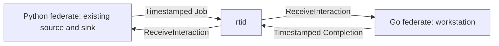

# Integrating existing models

The Python-Go queue example connects an existing Python DEVS source and sink
to a Go workstation. It is a small production-flow model: jobs arrive
periodically, wait for one workstation, and leave after service.

The example keeps model behavior separate from HLA integration. Python reuses
`PulseGenerator` and `PulseSink` from the
[pyjevsim model example](https://github.com/cbchoi/gorti/blob/main/examples/pyjevsim-real-model/models.py)
without changing their transition functions. Go implements a nonpreemptive,
first-come, first-served workstation with no HLA imports.

## Process and data flow



There are three independent processes: the two federates and the RTI server.
A startup-only ready/start barrier waits for declarations and time-management
callbacks. Jobs, completions, model state, and per-step decisions do not pass
through that barrier; job and completion messages use the RTI.

## Run on Windows or Linux

Install Go 1.22+ and Python 3.11+. Create and activate a Python environment
using the [installation guide](installation.md), then run from the repository
root:

```text
python -m pip install -e "./pysdk[dev,pyjevsim]"
python -m rti1516e._proto
```

The extra pins pyjevsim 2.1.2 source
`9893099b47aae89a3432c668b18ec4b6b15c043e`.

=== "Linux"

    ```bash
    bash examples/multilanguage-queue/run.sh \
      --output /tmp/gorti-model-results \
      --jobs 100 --repeats 3 --seed 1516
    ```

=== "Windows PowerShell"

    ```powershell
    .\examples\multilanguage-queue\run.ps1 `
      --output D:\results\gorti-model-results `
      --jobs 100 --repeats 3 --seed 1516
    ```

Choose a new output directory outside Git. The runner builds the Go server and
federate, starts each trial, checks its results, and stops only its own child
processes. It runs three repeats of each service profile: duration 1, duration
2, and seeded durations from 1 through 3.

## FOM and encoding

The [FOM](https://github.com/cbchoi/gorti/blob/main/examples/multilanguage-queue/federation.fom.xml)
defines two reliable, timestamp-ordered interactions:

| Model operation | HLA representation | Application mapping |
|---|---|---|
| Source emits a job | `HLAinteractionRoot.Job(seq, service)` | Adapter captures `out_seq` and invokes the original internal transition |
| Workstation receives a job | `ReceiveInteraction` | Pass arrival timestamp and decoded fields to `workstation.Server.Accept` |
| Workstation finishes | `HLAinteractionRoot.Completion(seq)` | Send the completion at the reserved finish time |
| Sink accepts completion | `ReceiveInteraction` | Adapter invokes the original sink external transition |
| Simulation advances | TAR and `TimeAdvanceGrant` | Advance each federate only after its grant |

Parameters are positive `HLAinteger32BE` values, encoded as four-byte
big-endian integers in both languages. Both federates are time regulating and
time constrained with lookahead 1. The source fires at logical times 1 through
N; the job arrives one logical unit later. That transfer delay is part of the
model, not measured network latency.

For each arrival, the workstation reserves service using:

```text
start = max(arrival, previous_finish)
finish = start + service_duration
waiting_time = start - arrival
```

There is no preemption or cancellation. Scheduling the completion when a job
arrives is therefore consistent with this model. Both federates use SDK
callback dispatch, not just raw transport receipt.

## Reference and retained results

The runner computes an independent time-stepped queue reference in Python.
It does not call the Go workstation. It compares arrival, service duration,
start, finish, and waiting time for every job, and separately checks completion
timestamps, source/sink identifiers, and the full grant sequences.

The retained 23 October campaign used Ubuntu 24.04/WSL 2, Go 1.22.2, and
Python 3.12.3. Each row contains three 100-job runs:

| Service duration | Final departure | Mean waiting time | Mean sojourn time | Maximum trajectory error |
|---|---:|---:|---:|---:|
| 1 | 102 | 0 | 1 | 0 |
| 2 | 202 | 49.5 | 51.5 | 0 |
| Seeded 1--3, seed 1516 | 206 | 49.85 | 51.89 | 0 |

All times are logical-time units. All nine runs passed: 900 jobs and 1,800
data callbacks. Repeats check deterministic behavior; this table does not
estimate wall-clock performance or a statistical confidence interval.
The reference is an independent queue implementation, not a full standalone
pyjevsim simulator run.

Each output directory contains inputs, reference and observed trajectories,
checks, process records, and logs. The campaign summary records runtime
versions, source/model hashes, binary hashes, and process identities.
The [technical guide](https://github.com/cbchoi/gorti/blob/main/engineering/verification/ieee1516-2010-test-case-guide.md)
records the source baseline and retained results.

## Replace a model

1. Keep the model's state transitions independent of HLA. Put FOM handle
   lookup, encoding, and callback dispatch in the federate adapter.
2. Define the shared quantities, units, identifiers, and byte encodings in the
   FOM. A shared parameter name alone does not establish an encoding agreement.
3. Choose which model outputs become interactions or object attributes.
   Map each received callback to a model input.
4. Define logical-time units, transfer delays, and lookahead. Ensure that
   timestamped sends respect the regulating federate's current time bound.
5. Build a standalone reference or an analytical expectation. Check model
   trajectories and accounting, not only successful network delivery.
6. Add explicit application-state persistence if the adapted model needs
   save/restore. RTI and SDK checkpoints do not automatically capture arbitrary
   simulator state.

For Java, the
[two-process exchange example](https://github.com/cbchoi/gorti/blob/main/examples/java-exchange/README.md)
shows synchronization, object updates, interactions, and evoked callbacks.
It is a separate example, not a third federate in the queue experiment.

## Troubleshooting

| Symptom | Action |
|---|---|
| Generated Python modules are missing | Run `python -m rti1516e._proto` in the same environment used by the launcher. |
| Output directory already exists | Select a new directory so a rerun cannot overwrite retained evidence. |
| WSL cannot read Windows worktree Git metadata | Obtain the full commit with Windows Git and pass `--source-commit`; the manifest labels it caller-supplied and retains file hashes. |
| Time advancement stalls after a model change | Inspect both federates' regulation, constraint, lookahead, pending requests, and callback dispatch. |
| Model results differ although message counts match | Compare per-job timestamps, parameters, ordering, and trajectories in the trial output. |

See [time management](time-management.md) for coordination rules and the
[example README](https://github.com/cbchoi/gorti/blob/main/examples/multilanguage-queue/README.md)
for runner details.
