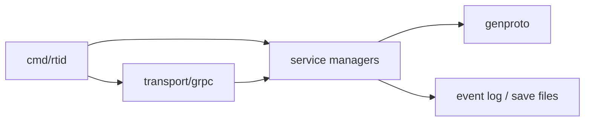
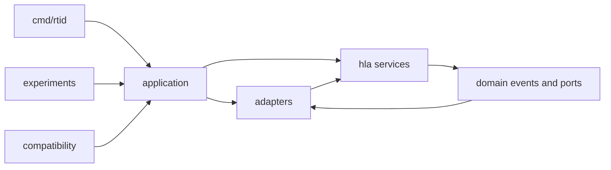

# HLA/RTI Refactoring Report

Status: Implemented
Branch: `codex/hla-rti-refactor`
Updated: 2026-08-05

## 1. Purpose

This refactoring separates IEEE 1516 service behavior from transport,
serialization, persistence, observability, and process bootstrap code. It keeps
one Go module and uses package boundaries rather than separately versioned Go
modules. The public Protobuf/gRPC protocol, SDK entry points, CLI flags,
configuration behavior, and existing HLA semantics remain the compatibility
boundary.

## 2. Previous structure and problems

The previous package tree grouped code mainly by its implementation history.
HLA managers, generated messages, gRPC callbacks, persistence, metrics, demos,
and process configuration were adjacent under `rti/internal` or
`rti/cmd/rtid`. This caused four recurring problems:

1. service managers constructed generated Protobuf callback messages;
2. snapshot managers knew their Protobuf storage representation;
3. filesystem, event-log, delivery, and metrics responsibilities were difficult
   to distinguish from HLA state transitions; and
4. `rti/cmd/rtid/main.go` combined entry-point, configuration, composition, and
   lifecycle responsibilities.



## 3. Resulting structure



The enforced dependency direction is:

```text
cmd -> application -> adapters -> hla/core
                  \-> hla services -> hla/core
experiments/compatibility -> application composition
```

Production files below `rti/internal/hla` cannot import adapter packages,
gRPC, generated Protobuf, Prometheus, HTTP, `os`, or `path/filepath`.
`tests/architecture/dependencies_test.go` parses imports and enforces the rule.

## 4. File and package movement

| Previous location | Current location | Reason |
|---|---|---|
| `rti/internal/core` | `rti/internal/hla/core` | Identify shared domain contracts as part of the HLA core |
| `rti/internal/federation` | `rti/internal/hla/federation` | Federation Management ownership |
| `rti/internal/declaration` | `rti/internal/hla/declaration` | Declaration Management ownership |
| `rti/internal/object` | `rti/internal/hla/object` | Object Management ownership |
| `rti/internal/time` | `rti/internal/hla/time` | Time Management ownership |
| `rti/internal/ownership` | `rti/internal/hla/ownership` | Ownership Management ownership |
| `rti/internal/ddm` | `rti/internal/hla/ddm` | Data Distribution Management ownership |
| `rti/internal/sync` | `rti/internal/hla/synchronization` | Synchronization state and callbacks |
| `rti/internal/savepoint` service logic | `rti/internal/hla/save_restore` | Storage-independent save/restore coordination |
| `rti/internal/mom` | `rti/internal/hla/mom` | MOM state and requests |
| support logic in gRPC handlers | `rti/internal/hla/support` | Reusable FOM and object-instance queries |
| `rti/internal/transport/grpc` | `rti/internal/adapters/grpc` | Wire adapter boundary |
| `rti/internal/genproto` | `rti/internal/adapters/protobuf` | Generated code isolation |
| outbox code in `cmd/rtid` | `rti/internal/adapters/delivery` | Delivery queue and ACK ownership |
| `rti/internal/eventlog` | `rti/internal/adapters/eventlog` | Persistence representation and replay |
| save bundle and filesystem code | `rti/internal/adapters/savebundle` | Snapshot codec and storage ownership |
| metrics code in `cmd/rtid` | `rti/internal/adapters/observability` | Operational adapter ownership |
| OIDC and TLS test support | `rti/internal/adapters/auth`, `rti/tests/testkit/testtls` | Separate production authentication from fixtures |
| `rti/internal/research` | `rti/internal/compatibility/researchconfig` | Retain existing configuration without domain coupling |
| alternative grant/ownership algorithms | `rti/experiments/algorithms` | Keep non-default educational algorithms outside core |
| cluster and replication prototypes | `rti/experiments/cluster` | Keep distributed experiments outside HLA services |
| `rti/internal/perf`, `cmd/perf-baseline` | `rti/benchmark/gortiperf`, `rti/benchmark/cmd/perf-baseline` | Consolidate benchmark-only code |
| `rti/spec` | `rti/tests/integration/spec` | Separate cross-package behavioral contracts from production packages |

The executable at `rti/cmd/rtid/main.go` now delegates directly to the
application server. The application package owns argument handling and the
composition root; configuration, lifecycle hooks, and the FOM repository are
separate application packages.

## 5. SRP results

| Responsibility | Owner after refactoring |
|---|---|
| HLA validation and state transition | Individual `hla` service package |
| Shared handles, errors, clocks, and ports | `hla/core` |
| Domain callback to `FederateEvent` mapping | `adapters/grpc` |
| Domain journal to persisted event mapping | `adapters/eventlog` |
| State DTO to save-bundle mapping | `adapters/savebundle` |
| Filesystem save storage | `adapters/savebundle/storage` |
| Queue admission, batching, outbox, and ACK progress | `adapters/delivery` and transport stream adapters |
| Generated schema bindings | `adapters/protobuf` |
| Runtime configuration policy | `application/configuration` |
| Lifecycle hook chaining | `application/lifecycle` |
| FOM repository and service wiring | `application/composition` and `application/server` |

Declaration, synchronization, ownership, save/restore, MOM, and Object
Management now emit typed domain callback values. The gRPC adapter has one
canonical outbound-event encoder. Synchronization, ownership, MOM, and DDM
export persistence-neutral state DTOs; save-bundle codecs retain the previous
wire representation.

The old `FakeClock` production name was replaced by `ManualClock`. It remains a
legitimate deterministic clock for examples and reproducible execution, not a
test-only production API. TLS fixtures live under `rti/tests/testkit`.

## 6. Algorithm extension

Default LBTS/grant and ownership strategies remain compiled with their HLA
service packages. Non-default eager-grant, maximum-projected-time, and random
acquirer implementations moved to `rti/experiments/algorithms`. The retained
research-config compatibility registry selects the same implementations as
before. Selection happens during application composition; no dynamic Go plugin
is required for an HLA algorithm.

## 7. Compatibility controls

### 7.1 Wire protocol

The source `.proto` files and their `go_package` descriptor options were not
changed. Buf now writes generated Go files physically to the Protobuf adapter.
The complete deterministic descriptor set and sorted RPC surface are protected
by golden SHA-256 values:

| Surface | SHA-256 |
|---|---|
| Protobuf descriptors | `e887db548b30d5fd76b90d204f2887a63d583648be44447a464362dcd7cba053` |
| RPC methods and streaming modes | `2734fc03178b6ca07c04f1ef9db669f08414239f680f4ae4fa4ed806651d1466` |

CLI flags, the Go/Python/C++ SDK protocol, and the public RPC list are unchanged.
CI, release checks, and `scripts/ci-gates.sh` now verify generated files at the
adapter location.

### 7.2 Persistence

`adapters/eventlog` converts `core.ObjectJournalRecord` to the existing
`rtiv1.Event` representation. The writer still accepts the legacy Protobuf
record type where required for replay compatibility. Save-bundle codecs map
domain synchronization, ownership, MOM, and DDM states to the existing bundle
messages. Filesystem behavior moved without changing bundle paths or formats.

Existing event-log generation, truncation, replay, save manifest, restore, and
manager round-trip tests pass in their adapter packages and integration suite.

## 8. Test organization decision

All former `rti/spec` contracts moved to `rti/tests/integration/spec`, and
shared TLS support moved to `rti/tests/testkit`. Benchmark-only production code
moved to benchmark packages. Production APIs with `ForTest` or exported `Fake`
names are rejected by the architecture gate.

Package-local white-box `_test.go` files remain beside the implementation they
inspect. Moving those files to a different import path would remove access to
unexported invariants and would require public test-only APIs, which this design
explicitly forbids. Cross-package behavior is tested under `rti/tests` and
top-level `tests`; implementation-level concurrency and invariant tests remain
co-located. This is the deliberate exception to the initial physical rule that
no `_test.go` file remain under `rti`.

## 9. Verification results

| Check | Result on 2026-08-05 |
|---|---|
| Baseline `go test ./...` before movement | Pass |
| Refactored `go test ./...` | Pass |
| HLA dependency architecture test | Pass |
| Descriptor and RPC golden test | Pass |
| Moved integration specification suite | Pass |
| Go SDK and Go examples included in full suite | Pass |
| Python benchmark harness unit tests | Pass: 34 common, 21 workload, and 36 comparison tests |
| Python SDK pytest | Not run: `pytest` is not installed in the local interpreter |
| Go race suite | Not run: local Go requires CGO and no GCC is installed |
| C++ SDK and IVCT subset | Not rerun locally in this refactoring session |
| Strict MkDocs build | Not run: `mkdocs` is not installed in the local interpreter |
| Buf regeneration | Not run: `buf` is not installed locally; output and CI paths were updated |
| DEVStone-HLA external comparison | Baseline dry-run completed; no claim-grade external run because the configured external output/FOM provenance was unavailable |

### 9.1 Object-service microbenchmark

Both source trees were run from the same machine and Go environment with
`-benchtime=300ms -count=3`. Values are the median of three samples for the
`hla-core` profile. These short runs detect a local regression; they are not a
replacement for the repository's paired DEVStone-HLA protocol.

| Operation | `main` median | Refactored median | Change | Allocations |
|---|---:|---:|---:|---:|
| RO interaction | 380.8 ns/op | 374.3 ns/op | -1.7% | 6 -> 5 |
| Reserved TSO interaction | 487.6 ns/op | 441.1 ns/op | -9.5% | 9 -> 8 |
| RO attribute update | 492.0 ns/op | 469.3 ns/op | -4.6% | 6 -> 5 |

The result shows no meaningful hot-path latency regression in this sample and
one fewer allocation per measured operation. Allocated bytes increased by 32,
32, and 16 bytes respectively, so future optimization should consider both
allocation count and total bytes.

## 10. Follow-up constraints

The application server composition remains intentionally centralized so all
existing flags and startup behavior use one compatibility path. Further file
splitting inside `application/server` is mechanical and can proceed without
moving policy back into `cmd/rtid` or HLA packages. Before merging, CI should
run the race, Python, C++, conformance, and documentation lanes in provisioned
environments, and a claim-grade DEVStone-HLA run should use the protocol in the
current STD.
