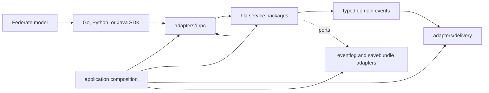

# Software Design Description

Document version: 4.6
Status: Current implementation profile
Updated: 2026-10-18

## 1. Architecture

The server separates HLA service rules from transport, storage, and application
composition. Go and Python provide native product interfaces; Java provides
the `hla.rti1516e` mapping. Current behavior includes dynamic FOM joins, typed
logical time, DDM association lifecycle, timed save/restore, and callback/SDK
state recovery.

gorti uses a standalone RTI process and separate federate processes. The
server owns authoritative federation state; SDKs translate language-specific
calls and callbacks to the common wire contract.

The federation manager owns the immutable logical-time implementation name.
Create admission resolves it before FOM loading; list/join, MOM and save manifests
read that selection. Restore validates compatibility before applying state.
The object registry stores the class conveyed at discovery per object/federate.
Ownership state stays in registered-class coordinates; request and callback
boundaries translate inherited attributes by name. Snapshot versioning preserves
that discovery history without inferring it from later subscriptions. See the
[time-selection and known-class increment](../../verification/ieee1516-2010-time-selection-known-class-20260930.md)
for the original implementation record.

Public ownership commands retain caller-known attribute coordinates until the
ownership manager acquires the registry preparation lease. Mapping, validation,
and ownership mutation share that lease; callbacks execute after it is released.
The registered-coordinate interface remains available for internal calls and
algorithm compositions. Release denial reserves callback capacity without service
locks, then reacquires the lease and revalidates both the mapping and pending
requests before commit. See the
[atomic ownership follow-up](../../verification/ieee1516-2010-ownership-atomic-20260930.md).

DDM stores update-region associations separately for the current owner and for
nonowners awaiting acquisition. Object-pinned ownership transitions activate and
discard the appropriate entries. Save/restore preserves inactive associations and
validates them against the associator's remembered object class. Cancellable
ownership assumptions also carry a process-local knowledge epoch through delivery;
obsolete offers are suppressed at server dispatch. Negotiated terminal ownership
receipts instead retain an obligation through actual SDK callback invocation;
transport admission is not completion. The root selects typed time, object and
checkpoint managers per federation, supporting Float64 and Integer64 together on
the single-server gRPC backend. See the
[DDM and knowledge-epoch increment](../../verification/ieee1516-2010-ddm-epochs-20260930.md).



The single Go module is divided by responsibility:

| Layer | Packages | Responsibility |
|---|---|---|
| HLA domain | `rti/internal/hla/*` | Federation, declaration, object, time, ownership, DDM, synchronization, save/restore, MOM, and Support rules |
| Application | `rti/internal/application/*` | Configuration policy, lifecycle hooks, composition, runtime plugins, and server bootstrap |
| Adapters | `rti/internal/adapters/*` | gRPC, generated Protobuf, delivery queues, persistence, authentication, metrics, and DDS |
| Compatibility | `rti/internal/compatibility/*` | Existing research-configuration behavior without coupling it to HLA services |
| Experiments | `rti/experiments/*` | Non-default algorithms and cluster/replication experiments |
| Tests | `rti/tests/integration`, `tests/*` | Cross-package contracts, conformance fixtures, architecture rules, and shared test support |
| Benchmarks | `rti/benchmark/*`, `benchmark/*` | RTI microbenchmarks and cross-product experiment harnesses |

The principal HLA packages are:

| Package | Responsibility |
|---|---|
| `hla/core` | Domain handles, errors, clocks, ports, and shared contracts |
| `hla/federation` | Federation generation and membership |
| `hla/declaration` | Publication and subscription state |
| `hla/object` | Object registry, interaction validation, and atomic fanout |
| `hla/time` | Logical time, separate RO/TSO queues, eligibility, LBTS, requests, and grants |
| `hla/ownership` | Attribute ownership state transitions |
| `hla/ddm` | Dimensions, regions, and routing predicates |
| `hla/synchronization` | Synchronization-point state transitions |
| `hla/save_restore` | Save/restore coordination independent of storage |
| `hla/mom` | Management Object Model state and requests |
| `hla/support` | FOM and object-instance support queries |

Production files in `rti/internal/hla` do not import gRPC, generated Protobuf,
Prometheus, HTTP, or filesystem packages. An executable architecture test
enforces this rule. HLA services emit typed domain callbacks and persistence
DTOs; adapters perform wire encoding, queueing, storage, and observation.

`rti/cmd/rtid/main.go` contains only the executable entry point. Argument
handling and composition are owned by `rti/internal/application/server`, with
runtime policy, repositories, and lifecycle helpers delegated to their
application packages.

## 2. Dependency direction

Dependencies point inward:

```text
cmd/rtid
  -> application
      -> adapters
      -> hla
adapters
  -> hla contracts
hla services
  -> hla/core and selected sibling HLA packages
```

The current sibling dependencies are MOM to declaration types and object
transportation preparation to ownership types. Infrastructure imports remain
outside the HLA layer.

An HLA service may depend on a narrow port such as a clock, event sink,
outbox, or snapshot boundary. The application layer supplies an adapter at
composition time. Domain state DTOs do not contain generated wire messages.

The source schema remains under `proto/rti/v1`. Generated Go bindings are
isolated under `rti/internal/adapters/protobuf/rti/v1`; descriptor and RPC
golden tests prevent an accidental public wire change.

## 3. State ownership

All mutable service state is keyed by federation name and generation. A newly
created federation receives a generation distinct from every prior instance
of that name. Requests, queued delivery, acknowledgements, and callbacks carry
or resolve against that generation so stale work cannot mutate a replacement
federation.

Each service manager serializes transitions over its own state. Cross-service
operations use an explicit order: validate membership and generation, validate
FOM/declaration state, reserve all required recipients, record when configured,
commit the transition, then expose the ACK or callback.

Live FOM composition uses immutable views and a per-federation writer lease.
The join path prepares an extension and reserves publication before recording
the JOIN. Failed admission or recording does not publish the candidate view.
The repository retains append-only handle bindings, not just the merged XML;
snapshots store both. Post-join MOM publication runs outside the exclusive
membership lease.

## 4. Object and interaction delivery

Region-scoped registration is coordinated by `hla/object` through
`core.ObjectRegionRegistrar`. DDM validates and pins every binding while the
registry commits the name and instance. One publication snapshot supplies
initial ownership and discovery eligibility. Ownership is initialized before
the object lock is released, and callbacks run afterward. Failed validation or
journal append preserves the object counter, reservation and associations.
This registration path does not yet reserve discovery callbacks atomically;
the reservation sequence below describes update/interaction delivery.

FOM dimension references are retained in the immutable model and resolved by
`application/composition`. The frozen audit codec rejects scoped registration
records because its replay format cannot reproduce the region state. The
production observer reports that recording failure without blocking HLA
services; that journal is incomplete. Same-roster save bundles preserve the
DDM state separately.

Once an operation reaches the server, the server-side path is:

1. Resolve the federation and verify the sender's current membership and any
   available generation evidence.
2. Validate class, attributes or parameters, publication, order, and timestamp.
3. Compute recipients from subscriptions and DDM predicates.
4. Reserve capacity for the entire recipient set.
5. Record the accepted operation when an audit adapter is configured and commit
   the reservations.
6. Emit typed domain callbacks for adapter delivery in deterministic order.

Preferred-order classification is independent of federation mode. Attribute
instance and publisher interaction-class overrides precede FOM defaults.
`attributeDeliveries` partitions mixed updates by effective order and
transportation, retaining RO region-set groups for release filtering. Deletion
uses the effective order of `HLAprivilegeToDeleteObject`. Missing order metadata
or a missing deletion-privilege attribute retains the existing timestamp-order
fallback for timestamped embedded-model calls; untimestamped sends remain RO.
Original callback timestamps are separate from the ordering key. Sent-order
metadata follows classification; received order also depends on receiver
constraint. Timestamp-order admission and retraction tracking apply only to the
TSO-classified portion, including TSO attributes with no subscribers.

The message-delivery gate classifies each recipient under the federation
evaluator lease. RO reflections, interactions and removals enter a separate
queue when the receiver is constrained, not advancing and not asynchronous.
Eligible recipients can proceed to the outbox; constrained TSO messages retain
their advance gate even at current logical time. Initial fanout admission remains
atomic across immediate and waiting recipients. Later release of accepted queues
may proceed in bounded prefixes; this is not partial admission of a new send.

`core.QueuedMessageFilter` lets the time service recheck current subscriptions
without importing the object registry. `hla/object` implements the filter for
queued RO reflections and interactions using retained class and region
identities; it copies an attribute map when trimming it so retry can use the
original message. Removal retains its prior-discovery meaning. With the FDD
delay-subscription switch enabled, the registry retains canonical payloads for
members joined when the message was generated and evaluates current interest
when delivery becomes eligible. Sender regional realizations are immutable
values, not later lookups of mutable region specifications. Registered-class
attribute projection is deferred until the recipient's known-class view is
available. Conditional discovery and exhaustive regional cases remain subject
to the source-derived coverage review.

The optional LocalLRC path uses a bounded local queue, persistent pipelined
stream, sequence numbers, negotiated operation batches, and cumulative ACKs.
Batch size and ACK cadence are independent. Some Go untimed OM methods use this
path by default and return at local queue admission. Callers that require server
confirmation wait for the cumulative ACK or select an explicit confirmed path.

The callback transport opportunistically combines ready event batches up to a
fixed bound. It never waits to fill a larger frame, and a time-advance grant
forces an immediate boundary after all preceding required RO and TSO events.

## 5. Time Management

Each joined federate has current logical time, lookahead, regulation and
constraint flags, asynchronous-delivery state, one optional pending advance
request, and separate RO and TSO input queues. RO eligibility is nonconstrained
OR advancing OR asynchronous. An optional timestamp stays in the RO callback
but does not enter GALT/LITS calculations. Discovery and control callbacks do
not enter the RO gate.

`recordAdvance` accepts finite targets for all five modes without requiring
regulation or constraint. Membership is enforced by the production service
boundary before the manager is called. Target validation precedes creation of
advance state. Unconstrained candidates bypass the GALT grant bound and do not
use incoming messages to select an earlier next-message target; pending-request
and scheduled-save rules remain in force.

Constrained TSO is queued until advance evaluation, including timestamps equal
to the last grant and receivers with asynchronous delivery enabled. NMR/NMRA
target selection includes an earliest queued timestamp equal to current time.
Snapshot/export includes advance-only state even without regulation-state
entries. Import preserves current time and held same-current-time TSO without
emitting callbacks; subsequent mode enablement does not reset that time.

Outgoing TSO validation selects requested time while an advance is pending and
current granted time otherwise. This time-base correction is covered for all
five modes and an early next-message grant. A per-federation evaluator lease
now spans final sender validation and queue/outbox admission. Advance recording,
lookahead changes and regulation changes acquire the same lease; observers run
after its release. Delivery of an already accepted deferred deletion does not
revalidate the original sender timestamp against a later time.

Strict TAR/NMR grant history survives a same-time Available grant and is stored
in time snapshot versions 3 and 4. A numeric adapter uses the next representable
float64 value for an exclusive finite zero-lookahead bound in the production
Float64 domain; it is distinct from the logical-time-interval epsilon.
Delayed subscription evaluation retains the candidate roster and rechecks
ordinary and regional interest before delivery. Callback projection preserves
the original queued payload so a retry can evaluate the current subscriptions.
Time state v5 and retraction state v2 preserve activation, receive guarantees,
FQR progress, and retraction state. Object state v3 retains recipient deletion
knowledge separately from authoritative object retirement. FQR selects its
grant after filtered delivery; NMR/NMRA reevaluate after each eligible timestamp
group.

`time.ManagerOf[T]`, `object.RegistryOf[T]`, `save_restore.ManagerOf[T]` and
`core.MessageDeliveryOf[T]` retain the selected numeric domain through requests,
queues, deletion, retraction and save scheduling. Integer64 uses checked `int64`
arithmetic without a Float64 intermediate; `TimeBoundOf[T]` distinguishes finite
final time from an unbounded horizon. `grpc.NewServerOf[T]` composes typed unary
OM, TM, regional interaction and savepoint adapters and exact callback encoders.
The root selects the typed backend using the execution's factory identity.
Integer64 requests cannot use the Float64-only interaction, ConfirmedObject or
LocalLRC request streams. Those decoders reject a representation mismatch before
admission; the ordinary unary path remains available.

GALT queries and MOM use a coherent observation under the same evaluator lease
as outgoing admission. Pending TAR/TARA contribute their requested horizon with
projected actual lookahead. Early next-message grants and FQR are accounted for
before taking the minimum of the other regulators' bounds. LITS also considers
the recipient's pending TSO timestamps. The
[third batch](../../verification/ieee1516-2010-third-batch-20260922.md) records
the implemented bounds and their verification scope. This bound observation does
not by itself establish FQR flushing; that behavior has the separate record above.

For an accepted advance request the server:

1. records the request, making queued RO messages eligible, and computes the
   safe grant bound;
2. releases applicable RO messages even when a regulating peer, lookahead bound
   or earlier TSO event blocks the grant;
3. reserves the remaining required RO and eligible TSO callbacks followed by one
   grant, or releases a bounded prefix if the transport cannot hold that sequence;
4. commits current time and clears pending state before making the grant
   visible; and
5. releases callbacks and the grant in that order.

Holding the state transition across the visibility boundary prevents a client
that immediately submits its next request from observing the previous pending
state. Delivery or reservation failure withholds the grant. LBTS/grant and
ownership selection use small strategy contracts. Default implementations
remain in the HLA packages; experimental alternatives are compiled from
`rti/experiments/algorithms` and selected through application composition.

An unsent suffix returns to its owning RO or TSO queue; already released messages
are not retried. Failed grant release preserves the pending request and marks
the federation for reevaluation. One application-owned retry worker acquires
checkpoint admission and a current-generation lease before retrying. Its start,
cancellation and joined shutdown belong to the server lifecycle, not the HLA
algorithm package. It requires neither peer activity nor another advance call.

Enabling asynchronous delivery or disabling constraint keeps the new setting
when a capacity limit prevents a full drain, with the remainder handled by that
worker. Other drain errors restore the prior flag and retain unsent messages.
This state-change completion is distinct from complete callback delivery.

Scheduled saves introduce a checkpoint boundary without discarding each
participant's original advance target. Eligible RO and required TSO events
precede initiation. Completion or restoration resumes saved requests through the
same time service, after the terminal save/restore callback boundary.

## 6. Federation lifecycle and teardown

Join installs all per-federate state before callbacks can be emitted. An explicit
MIM expectation is checked before additional FOM publication or handle allocation.
The repository retains the selected MIM separately from ordinary FOM modules in
live views and snapshots; omission continues to use the embedded MIM.

Explicit creation rejects the reserved `HLAstandardMIM` designator before
model loading or federation publication. FDD transportation/rate merging checks
operational fields independently from retained descriptions. Equal operational
definitions keep the first supplied description and can fill an absent one;
different descriptions alone no longer reject those definitions.

Resign commits the selected ownership and object cleanup and removes membership
under exclusive lifecycle admission. A terminal MOM observation runs before
derived-state cleanup removes its subject, subscriptions and callback queue.
It uses the actual retired identity and suppresses the ordinary interceptor's
duplicate observation. Reporting failure does not change the service result.
Destroy requires an empty federation,
closes optional plugin and transport resources, clears all manager state for the
generation, and only then allows the name to be reused.

## 7. Persistence and replay

The default composition loads no audit provider. Guarded producers therefore
skip record construction, encoding, and storage on the HLA core path. The
optional audit/replay plugin receives domain journal records through a core
port. `adapters/eventlog` converts them to the existing Protobuf-backed format.

Save and restore managers export persistence-neutral state DTOs. The
`adapters/savebundle` codecs translate synchronization, ownership, DDM, and MOM
state to the existing bundle messages. Filesystem access resides in
`adapters/savebundle/storage`. Legacy manifest version 1 and current version 2
read compatibility remain covered by fixtures.

The time component selects version 4 when any federate has queued RO messages.
Otherwise it retains version 3 for strict zero-lookahead history, version 2 for
a pending lookahead reduction, or version 1. The v4 `ro_queue` is separate from
the TSO `queue`; original callback timestamps, payloads, binary tags and metadata
are retained rather than interpreted as RO ordering keys. Version validation
rejects RO extensions labeled v1-v3, including empty or null `ro_queue` fields.
TSO timestamp checks remain unchanged. No manifest or RPC version changes.

Restore graph checks permit accepted RO messages whose object was already
removed or whose producer resigned, while rejecting invalid typed references.
Rebinding changes recipient, sender and producer identities, not object or region
handles. Import replaces current domain queues with the validated saved queues;
delivery eligibility is evaluated from restored state after terminal callback
publication. Runtime retry hints are not persisted as HLA state.

Complete-state restoration prepares the FOM image before dependent service
images, pins the saved-name/current-participant mapping and reserves terminal
callbacks before committing. The delivery adapter discards old queued callbacks
and rotates their epoch while retaining callback streams. Participant join-module
history is restored with the identity. MOM periodic publication enters the
checkpoint admission barrier before taking its reporting lock.

`adapters/grpc.CallbackCheckpoint` adds optional `callback_pending` state to the
save bundle. The mandatory receipt ledger retains unentered discovery, data and control
callbacks even after transport delivery. Capture strips old capabilities and
preserves distinct equal messages in admission order. Restore validates the
candidate FOM, exact time representation and phase-appropriate copied-region leases,
reserves replacement receipt/queue capacity, then publishes the identity/epoch
terminal before replay. Reconnect uses admission order rather than service
sequence numbers. Version 2 records stable invocation identity and pending,
outcome or completed phase. Entered bodies require a known saved SDK result and
are never replayed. Completed tombstones survive another save and restore until
bounded retention expires. Source validation occurs before persistence and
restore allocation; missing or contradictory outcomes fail closed.

The ledger retains the original lock-free callback guard. Explicitly cancellable
advice may retire only before invocation entry; terminal results do not use that
policy. Dispatch, reconnect and capture share reservation retirement, including
pending-count accounting. A completed reconciliation marker is retained across
failed sends and reconnect without acquiring a receipt or invoking user code.
Queued markers are pinned against ordinary completed-history eviction; replay
reserves their bounded capacity before publication. An identity-only completed
record remains identity-only and does not acquire an invented success/failure.

Synchronization captures are checked against saved immutable obligations and
reconciled after domain import but before publication, preventing duplicate
domain retry. Ownership IDs remain domain relationships; generation, callback
epoch and delivery attempts are freshly authenticated by the ownership adapter.
Late ownership identity assignment is observed before queue publication without
changing the frozen callback body. Historical lifecycle notifications do not
restart an SDK save/restore transaction.

Transportation confirmation stores an authority-free intent and explicit
activation phase. Saved FOM/object/ownership validation and cross-row conflict
checks precede target handle allocation. Fresh tickets and capacity leases are
prepared before domain import, using precollected live membership identities and
the actual planned callback epochs. Post-import installation is infallible and
does not apply transportation effects. All live and leased tickets, including
unconsumed activated acknowledgements, share the 4,096-ticket bound; replacement
credit excludes foreign federation tickets. Activated acknowledgements enter the
existing bounded completed cache only when consumed. Cleanup is one-shot and
cannot remove another federation's newer capacity lease.

An unexpected terminal-publication failure after domain import records a failed
restore and returns `ErrRestoreStateCommitted` with its underlying error. It does
not log successful restoration, fabricate a terminal callback or resume time.
Imported state remains committed; this error is not described as rollback.

`adapters/sdkstate` validates GRS1 Go/Python/Java runtime envelopes and translates
explicit federate references through narrow save/restore ports. Source validation
precedes target identity allocation. SDK hydration follows successful terminal
delivery, not restore initiation. The initiation's original saved handle is
distinct from the target-scoped private runtime identity. Stable live session
identity resolves to the restored handle under retained lifecycle admission;
name/generation/incarnation mismatches reject replacement memberships.

Private `pending_local_notifications` DTOs preserve completed-RPC notifications
that do not use the server callback stream. Python and Java stage the allowlisted
immutable results and dispatch them after the restore terminal, preserving local
FIFO and equal-payload multiplicity. The SDK adapter validates and rewrites only
explicit current-execution federate references. Historical saved status handles
and other federations' discovery metadata remain unchanged. These DTOs do not
enter the server invocation ledger, perform RPCs, or activate transportation
tickets. Arbitrary closures and pending Java activation closures reject export.
The contract does not introduce a mixed local/server total-order guarantee.

Explicit cross-generation restoration loads one exact source execution and
validates the complete typed snapshot graph against the saved FOM before
publication. The target generation, current FOM and consenting roster remain
pinned. Fresh target handles replace saved references, including historical
retraction producers. Live membership incarnations and authentication tokens
are not loaded from the bundle. Automatic resign directives and synchronization
failure history are saved state; session credentials are not.

`adapters/auth/session` issues capabilities at the join commit boundary and
observes authenticated callback connections. Expiry checks the membership
incarnation and disconnection condition inside the same exclusive operation
boundary as resign. A reconnect cancels pending expiry. Checkpoint admission
defers cleanup while save/restore is active.

Local validation hydration takes exclusive federation operation admission,
captures FOM, publication, object knowledge and ownership, then commits an
internal marker to the same ordered callback queue. The SDK installs the image
at that marker, not when the query response first arrives. Retired LocalLRC
tickets remain bound to their original stream outcome.

MOM service observations run at actual handler completion, including operations
inside persistent streams. Opaque callback receipts distinguish transport sends
from SDK callback invocation. Receipt accounting uses checkpoint observation
admission; it cannot grant ordinary mutations permission during save/restore.
Missing measurement coverage is represented explicitly rather than as zero.

Mandatory ownership receipts are independent of optional MOM accounting. An
enabled recipient's acquired, unavailable and acquisition-cancellation outcomes
enter the ownership ledger before commit and survive projection, admission or
send failure. Authenticated reports bind callback ID and delivery attempt to
federation generation and callback epoch. Only actual invocation completes the
obligation; raw event-channel consumption does not. Ownership snapshot version 3
retains enabled sessions and pending outcomes, not live credentials or transport
attempts. Restore prevalidates the complete scope-rebind batch and installs a fresh
epoch above saved and current epochs before publishing membership and queues.
Saved pending outcomes are invoked again; old-scope acknowledgements cannot retire
them. Server dispatch guards alone cannot fence advice already buffered in an SDK;
the wire-visible knowledge epoch and fenced local-delete response supply that
separate SDK boundary. Python and Java ambassadors attempt automatic receipt
negotiation on nonzero-generation joins, with delivery-only compatibility for an
unimplemented service. Selected Python and Java localhost campaigns exercise the
negotiation and receipt paths; raw consumers are not silently made strict.

Object-class unpublication prepares ownership relinquishment and reserves every
required recipient before committing declaration and object changes. The wire
adapter distinguishes whole-class omission from an explicitly empty attribute
set. Pending acquisition outcomes retain their recipient projection even after
object removal; failed admission leaves the previous publication intact.

Typed Integer64 persistence uses time component v6, object v5, retraction v3,
the MOM exact-value extension v2 and save-history v2, with an explicit
`HLAinteger64Time` discriminator. Decimal integers are decoded without a floating
intermediate, and restore rejects factory mismatch before publication. Legacy
Float64 readers and component versions remain supported; integer histories use
separate versioned storage. These codecs do not change production time selection.

FOM-dependent declaration state is validated against the unpublished saved
candidate, not the current live model. Importing DDM state invalidates its
dimension-view cache even if a later extension reuses an old revision number.
Retraction-ID history is a separate generation-scoped time-service ledger.
Each originating timestamped operation reserves its ID once before fanout;
successful admission records it independently of recipient count. Its snapshot
unions saved and live history on restore rather than rewinding it.

Update-rate demand is projected from declaration state, current ownership and
actual DDM overlap. Regional mutations hold the projection guard before object
and ownership leases and retain it through advisory admission or rollback.
This prevents a concurrent owner change from publishing rejected regional
demand. Rates advise producers; they are not a transport throttling mechanism.

## 8. Observability

Structured logging, authentication, metrics, and transport instrumentation are
adapter responsibilities. Performance instrumentation distinguishes caller to
confirmed ACK, server admission/service time, callback completion, and TAR to
exact TAG latency. Instrumentation does not enter HLA domain payloads.

DEBUG logging at startup enables optional per-binding outbox observation. It
counts all envelopes admitted, drained from the channel, invalidated at the
observation boundary, held in scratch space, or queued. The resign hook logs only
a detached, closed observation. Concurrent stream removal can leave no final log;
it must not produce a purported final snapshot of an open observation. Normal
logging levels allocate no observation state. These local diagnostics do not
supply end-to-end MOM RO/TSO lengths or prove SDK callback invocation.

MOM obtains RO and TSO data-queue lengths through `core.ReadyDataQueue` and the
selected time manager. The time evaluator lease protects waiting-to-ready
transfers while the transport source counts admitted, receiver-specific receipts
until authenticated callback entry. Equal payloads remain distinct messages;
control callbacks, tentative reservations and already-entered callbacks are
excluded. Missing coverage or an unknown received-order value is an error, not a
zero measurement. This composition has bounded production entry tests; complete
conservation across restore and all failure paths remains under verification.

Incoming MOM data counters use a separate callback-entry observer. Required DDM
and synchronization lifecycle work precedes optional measurement work. Incoming
class/runtime counters advance once at authenticated entry, not fanout admission
or outcome. When this observer is configured, pending outcomes do not mask the
three entry-authoritative incoming data metrics; failures still do. Legacy and
control counters retain their existing availability rules. Measurement failure
marks missing coverage without blocking the callback body.

Per-class traffic counters retain Reliable and BestEffort partitions. Sender
hooks capture the accepted transport before post-commit observers can change an
override; mixed attribute updates contribute once per used transport partition,
independently of receiver count. Receiver partitions advance at authenticated
entry using the delivered callback metadata. Traffic snapshot v1 Reliable data
remains readable; v2 additionally stores BestEffort counts.

MOM HLAfederate attribute publication uses a narrow point-delivery port composed
with the selected typed object manager. Ordinary and regional subscriptions are
combined before atomic callback admission. Late-subscription publication runs
after DDM commit and outside its mutation locks. Conveyed region copies have
explicit query lifetimes. The production MOM tests execute the 32-service
catalog in both time families, with effect and report assertions; the
[callback/SDK/MOM report](../../verification/ieee1516-2010-callback-sdk-mom-20261001.md)
records those cases.

## 9. Extension rules

New transports implement adapter contracts. A new standard algorithm belongs
in its HLA service package behind the smallest useful strategy interface. An
educational or non-standard algorithm belongs in `rti/experiments/algorithms`
and is selected by a separately composed binary or the retained research-config
compatibility adapter. Dynamic Go plugins are not used for algorithm selection.

No optimization is accepted when it changes callback order, error visibility,
durability, generation fencing, backpressure, or the measured completion
boundary without a corresponding interface and specification change.
